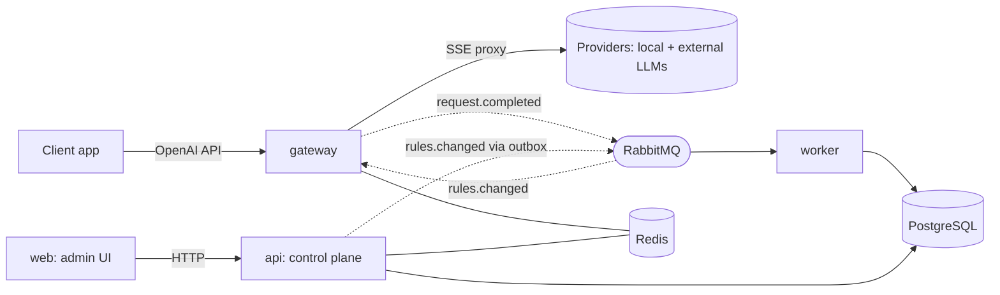

# Switchyard

[](https://github.com/Stepan1709/switchyard/actions/workflows/ci.yml)


A self-hosted, OpenAI-compatible LLM gateway. It records real application traffic, replays it on local and external models of different sizes, compares quality, latency and cost, and lets a human choose routing rules: which kind of request is handled by which model. The gateway then applies the rules in production and reports spend, savings, server utilisation and user feedback.

Use it by changing one line in your application: the `base_url` of its OpenAI client points at the gateway (`https://<host>/v1`), and the API key is a key created in the web interface. Send an `x-task-type` header to say what kind of request it is.

## Architecture



- **gateway** - data plane: key check, model choice from an in-memory snapshot, streaming proxy, traffic events. No database on the hot path.
- **api** - control plane: projects, keys, providers, models, calibrations, rules, analytics.
- **worker** - same image, background consumers: traffic log writer, replay and judge jobs, aggregates.
- **web** - admin UI (FastAPI + Jinja2 + HTMX).
- PostgreSQL stores configuration, traffic logs and results; Redis holds caches, rate limits and sessions; RabbitMQ carries events and jobs.

## Quick start

Requirements: Linux or WSL2, Docker with Compose v2, `make`, `uv`, `git`.

```bash
make secrets   # random dev passwords in deploy/secrets/dev (not committed)
make up        # postgres, redis, rabbitmq, migrations, api, gateway, worker, web, mock_llm + Adminer; waits for healthchecks
make test      # unit and integration tests (integration tests start containers via Docker)
make e2e       # the whole product path on the running stack
make lint      # ruff + mypy
make migrate   # apply database migrations (also runs automatically before api on `make up`)
make create-admin EMAIL=you@example.com   # create an administrator (password prompt)
make down
```

Dev endpoints (localhost only): admin web interface `:8002`, gateway `:8000`, API `:8001` (`/docs`, `/health/live`, `/health/ready`), mock provider `:8003`, worker health `:8004`, Adminer `:8080`, RabbitMQ UI `:15672`, Postgres `:5433`, Redis `:6379`, AMQP `:5672`.
Run `make help` for all commands.

## Admin API: first steps

On `make up` the first administrator is created from `ADMIN_EMAIL` (see `.env`) and the dev secret
`deploy/secrets/dev/admin_password`, if no administrator exists yet. Interactive docs: `http://localhost:8001/docs`.

```bash
PW=$(cat deploy/secrets/dev/admin_password)
TOKEN=$(curl -s localhost:8001/auth/login -H 'content-type: application/json'   -d "{\"email\":\"admin@example.com\",\"password\":\"$PW\"}" | python3 -c 'import sys,json;print(json.load(sys.stdin)["access_token"])')
curl -s -X POST localhost:8001/projects -H "authorization: Bearer $TOKEN" -H 'content-type: application/json' -d '{"name":"demo"}'
# then POST /projects/{id}/keys: the response contains the client key (swy_...) exactly once
```

Access model: administrators (`admin` can change things, `viewer` is read-only) see only the projects they are members of.
Client API keys look like `swy_<prefix>_<secret>`; only the prefix and an HMAC of the secret are stored.

## Providers and models

`mock_llm` is an OpenAI-compatible provider simulator (`mock-tiny`, `mock-mid`, `mock-strong`, `mock-judge`) with
deterministic answers of different quality, streaming, `usage`, tool calls, context limits and failure injection
(`x-mock-fail: 500|503|429|timeout`, `x-mock-delay-ms`, `x-mock-output-tokens`, `x-mock-drop-after-chunks`).

```bash
# register the mock as a self-hosted provider, add a model, check the connection
curl -s -X POST localhost:8001/providers -H "authorization: Bearer $TOKEN" -H 'content-type: application/json'   -d '{"name":"mock","base_url":"http://mock_llm:8003/v1","auth_type":"none","is_local":true}'
# POST /models, POST /models/{id}/prices (price history), POST /providers/{id}/test
```

Provider access keys are stored AES-256-GCM encrypted (key ring from the `master_keys` secret) and are only ever
returned masked. Provider addresses are validated against SSRF: cloud metadata and link-local ranges are always
rejected, private addresses are allowed only for providers marked `local` whose host is listed in
`LOCAL_PROVIDER_HOSTS`, and the connection goes to the address that was checked (not to the name again).

## Messaging, outbox and the worker

Events and jobs travel through RabbitMQ (`switchyard.events` topic exchange, `switchyard.dlx` for retries and dead
letters). Every work queue `Q` comes with `Q.retry.1..3` (delays 5 s, 30 s, 5 min through queue TTLs and the
dead-letter exchange) and `Q.dlq`:

- a handler that raises `TemporaryError` is retried with a growing delay, then dead-lettered;
- `PermanentError` (or any unexpected exception) goes to the DLQ at once, with the reason in the message headers;
- publishing waits for the broker's confirmation and is `mandatory`: an event nobody is subscribed to is reported;
- delivery is at-least-once, so consumers drop duplicates through the inbox (`processed_messages`, written in the same
  transaction as the business effect);
- events that must not be lost are written to the `outbox` table in the same transaction as the data, and a relay
  inside the worker publishes them (`FOR UPDATE SKIP LOCKED`, safe to run in several processes);
- unsafe admin `POST`s (projects, providers, models, prices) accept an `Idempotency-Key` header: a retry returns the
  stored response instead of repeating the action.

The `worker` container runs the consumers, the outbox relay and hourly cleanup, and stops gracefully on SIGTERM
(running handlers finish, unfinished messages go back to the queue).

```bash
python -m app.cli dlq list --queue worker.request_log            # what failed and why (no payloads)
python -m app.cli dlq requeue --queue worker.request_log --limit 10
```

## Gateway

An OpenAI-compatible proxy on port `8000`. An application only changes its `base_url` and API key:

```python
from openai import OpenAI

client = OpenAI(
    base_url="http://localhost:8000/v1", api_key="swy_..."
)  # key from POST /projects/{id}/keys
client.chat.completions.create(model="anything", messages=[...], stream=True)
```

In `record` mode (the only mode so far) every request goes to the project's **reference model**, whatever `model` the
application sends; the answer, including streams, tool calls and `usage`, comes back as the provider produced it.

- **Hot path without the database.** Keys, projects and routes live in an immutable in-memory snapshot, rebuilt in the
  background every 15 s (so a new or revoked key takes effect within that time). The last snapshot is also copied to Redis
  (provider keys only as ciphertext) so a gateway can start while PostgreSQL is down.
- **Streaming** is forwarded chunk by chunk without buffering. The gateway turns on `stream_options.include_usage` to
  learn the token counts and removes the extra usage-only event again if the client did not ask for it.
- **Client disconnect** closes the provider connection at once, so no tokens are generated for nobody.
- **Limits:** request body size, a per-key rate limit (`rate_limit_rpm`, default 600/min; `x-ratelimit-*` headers),
  concurrent requests per provider. Timeouts are separate for connect, first byte, idle time and total time.
- **Errors** use the OpenAI shape. Provider answers about the request itself (400, 413, 422, 429) are passed through;
  provider-side failures (401/403 of the gateway's own key, 404, 5xx, timeouts, unreachable) become 502/504 without the
  provider's body.
- Response headers: `x-request-id`, `x-switchyard-model` (which model answered), `x-switchyard-mode`. `x-task-type`
  sets the task type (default: the key's `default_task_type`).
- `GET /v1/models`, `GET /health/live`, `GET /health/ready` (ready as soon as a snapshot is loaded).

### Overhead

Measured with `MOCK_TIME_SCALE=0 make up && make bench` (instant mock, everything on one laptop under WSL2, so read the
numbers as relative; a proper load test comes later). Direct = client to the mock; gateway = client to the gateway to the
mock, so the difference includes the second HTTP hop.

| non-streaming, 300 sequential requests | p50 | p95 | p99 |
|---|---|---|---|
| direct to mock (ms) | 1.94 | 2.99 | 4.42 |
| through the gateway (ms) | 5.10 | 6.67 | 7.64 |
| overhead (ms) | 3.15 | 3.68 | 3.22 |

Streaming time to the first byte: 2.0 ms direct, 5.1 ms through the gateway (p50). With 32 concurrent clients one gateway
process handled about 160 requests/s against about 360 for the mock itself (the load generator shares the machine).

## Traffic log

Every request that passes the gateway becomes one row of the `requests` table (PostgreSQL, partitioned by month):

```
gateway ── request.completed ──► RabbitMQ ──► worker (batches, ON CONFLICT DO NOTHING) ──► requests
   └─ bounded local buffer while the broker is down (oldest events dropped and counted)
```

- The event is sent after the answer, from a background task; the client never waits for logging. If RabbitMQ is down the
  events wait in a bounded buffer (2000 events / 64 MiB; when full the oldest are dropped and `dropped_total` grows, shown
  in the gateway's `/health/ready`) and are delivered when the broker returns.
- The worker writes batches of up to 100 rows in one statement. The row key is `(started_at, request_id)`, so a
  re-delivered event changes nothing.
- A row has metadata (task type, model, status, tokens, time to first byte, duration, gateway overhead) and, unless the
  project says otherwise, the request and the answer as JSON. A streamed answer is stored as one assembled message.
  Bodies over 256 KiB are not stored (the row says `payload_skipped`).
- **Privacy, per project** (`PATCH /projects/{id}`): `store_bodies=false` keeps metadata only; `mask_pii=true` replaces
  e-mails, phone numbers and Luhn-valid card numbers with placeholders *in the gateway, before the event is sent*, so
  the raw values never reach the broker or the database (the client still gets the real answer).
- **Retention**: whole monthly partitions are dropped (`TRAFFIC_RETENTION_MONTHS`, default 3: the current month and the
  3 before it). New partitions are created ahead of time by the worker.
- **Task types**: `x-task-type` (or the key's default) is registered automatically on first sight, up to 50 per project;
  `GET/POST/PATCH /projects/{id}/task-types`. The modes `record`, `shadow` and `route` are described in the Routing section.
- **Reading it**: `GET /projects/{id}/requests` (filters `task_type`, `model`, `status`, `since`, `until`; keyset
  pagination with `cursor`) and `GET /projects/{id}/requests/{request_id}` (with the stored bodies).

### Query plans

Indexes `(project_id, started_at DESC, request_id DESC)` and `(project_id, task_type, started_at DESC, request_id DESC)`
serve the list view. `EXPLAIN (ANALYZE, BUFFERS)` on 300 000 generated rows in 3 monthly partitions (3 projects, one
project holding 0.1% of the rows, 3 task types):

| Query (`ORDER BY started_at DESC, request_id DESC LIMIT 51`) | Plan | Execution |
|---|---|---|
| project | the newest partition is read first, older partitions are `never executed` | 0.07 ms |
| project + task type | task-type index, 51 rows from the newest partition | 0.05 ms |
| rare project (0.1% of rows) | index-only scans over the project index, the oldest partition is skipped | 0.13 ms |
| next page with `since`/`until` | `Subplans Removed: 4` (partition pruning), then one backward index scan | 0.08 ms |

Without a time window the planner still opens every partition for planning, which is why `since`/`until` are worth
passing on a long retention.

## Calibration: replaying recorded traffic

A calibration run takes a sample of the requests recorded for one task type and replays them
on candidate models, to see what each of them would have answered, how fast, and at what price.

```
POST /projects/{id}/calibration-runs   (Idempotency-Key)
        │  one transaction: the run, a copy of the sampled requests, one `replay.execute` job
        │  per (request × candidate) in the outbox
        ▼
 RabbitMQ ──► worker: wait for a provider slot ─► reserve budget ─► call the candidate
                      ─► store the result (price that applied, tokens, TTFT, latency)
                      ─► the last result completes the run and emits `calibration.run.finished`
```

- **Request**: `task_type`, `candidate_model_ids`, `sample_size`, `strategy` (`random` or `stratified` by prompt length and
  presence of tools), `source` (`traffic`, `labeled` or `both`), optional `seed`, `since`/`until`, budget
  (`max_requests`, `max_cost_usd`) and `thresholds` for the later recommendation. The seed is stored, so a run can be
  reproduced.
- **Sample**: only successful requests answered by the project's reference model, with stored bodies, without duplicate
  prompts. The sampled requests are copied into the run, so it stays complete after the traffic partition is dropped.
- **Labelled examples**: `POST /projects/{id}/task-types/{name}/labeled-samples` takes JSON Lines
  (`{"messages": [...], "expected": "..."}`). The import is all or nothing and skips examples that are already there.
- **Replay**: the recorded request is sent as it was, with the model replaced, as a stream (to measure time to the first
  token). **Tools are never executed**: tool definitions go along, and a tool call in the answer is stored, nothing more. A
  prompt that does not fit the candidate's context is stored as `context_exceeded` and never sent.
- **Limits per provider** (Redis, shared by all workers): a number of simultaneous calls and a call rate
  (`calibration_max_concurrency`, `calibration_max_rps` on the provider; defaults in the settings). A slot has an expiry,
  so a killed worker does not block a provider.
- **Budget**: money is reserved before a call from an estimate and corrected after it; when the next call does not fit, the
  run ends as `budget_exceeded` (it does not finish silently). The truth is in the database; Redis counters are rebuilt from
  it if they are lost.
- **Steering**: `POST .../pause`, `.../resume`, `.../cancel`; progress is `GET .../calibration-runs/{id}`
  (counters per status, spent money, remaining budget); results are `GET .../results` (filters, keyset paging).
- **Failures**: a slow or overloaded provider is retried with growing delays and, when the retries are used up, recorded
  as an error result so the run can still finish. A killed worker loses nothing: its unacknowledged jobs go to another worker,
  and a result per `(run, request, model)` is unique.

### Quality evaluation

When a run ends, every successful answer is evaluated. The question it answers is honest and limited:
**how closely does this model behave like the reference on this kind of request** (or like a hand-labelled example, when
there is one). It is not an absolute measure of correctness, and the report always says what an answer was compared with.

Order of evaluation, from cheap and certain to expensive:

1. **Checks of the task type** (`POST /projects/{id}/task-types/{name}/checks`): `json_schema`, `exact_match`, `regex`,
   `tool_call_match` (the same tools with equal arguments; tools are compared, never executed), `llm_judge` (tunes the judge:
   minimum score, rubric). A check is *required* (a failure means "not passed") or optional (it only lowers the quality).
   `json_schema` supports a documented subset of JSON Schema and refuses anything else when it is configured.
2. **An answer equal to the truth** (labelled example first, then the reference's recorded answer) scores 1.0 and the judge
   is **not called**. The judge only sees answers that differ.
3. **The judge** (`judge_model_id` of the run; never a candidate, never the reference): grades the answer 1-5 against the
   truth, or with `judge_pairwise` compares the two answers in both orders (a judge that contradicts itself between the orders
   is position-biased and does not pass the answer). Temperature 0, a JSON reply validated by Pydantic, two repeats when
   the reply is invalid, then `judge_failed`: such an answer is left out of the statistics and counted separately (it is
   not a zero). Everything the candidate wrote goes between markers with a value it could not know, and the prompt, stored
   in the database by version, tells the judge to treat it as data.

Quality is on a 0-1 scale: a check counts 0 or 1, the judge counts (score - 1) / 4, quality is their mean. Hand-written
verdicts of people get a table now and outrank the judge once an interface fills it.

`GET .../calibration-runs/{id}/aggregates` returns, per model: quality (mean and lowest decile), pass rate with its Wilson
interval, tokens, latency p50/p95, time to first token, error rate, share of schema-valid answers, cost per request and the
judge's own cost. Fewer than 30 evaluated answers are marked `insufficient_data`. Example (60 recorded requests of a
classification task, `mock-strong` as the reference, `exact_match` check and a judge; the mock models have accuracies of
0.60 and 0.85):

| model | evaluated | quality | lowest decile | pass rate (95% interval) | same as reference | judge calls | cost per request |
|---|---|---|---|---|---|---|---|
| mock-tiny | 60 | 0.71 | 0.11 | 0.63 (0.51-0.74) | 38 | 22 | $0.0000028 |
| mock-mid | 60 | 0.88 | 0.38 | 0.83 (0.72-0.91) | 50 | 10 | $0.0000139 |

The judge was asked 32 times for 120 answers: the 88 answers equal to the reference needed no judge.

Limits worth knowing: if the reference is wrong, the candidates are measured against its mistakes (labelled examples and user
feedback are the counterweight); a different but equally valid sequence of tool calls is not credited automatically; and the
effect of an action is never checked, only the decision.

## Routing

A task type of a project is in one of three modes (`PATCH /projects/{id}/task-types/{name}`):

| mode | who answers | what else happens |
|---|---|---|
| `record` | the reference model | the request is logged |
| `shadow` | the reference model | a share (`shadow_rate`) of the requests is copied to `shadow_model_ids` in the background; their answers are stored in `shadow_results`, never shown to the client |
| `route` | the models of the **active rule**, in order | if the first fails before sending anything, the next one is tried |

**Rules.** A rule version is a chain of models (`routing_rules`). It is `proposed` by a recommendation or by hand, and only
a person activates it. The versions of one task type are numbered; exactly one can be active (a partial unique index in the
database, so two simultaneous activations cannot both win), and `POST .../activate` takes `expected_active_version`, the
version the person saw as active: if somebody changed it meanwhile the answer is 409 and nothing changes. Rolling back
(`POST .../rules/rollback`) is one step: the version the active one replaced comes back; with nothing to come back to, the task
type returns to `record`. Every change is audited and announced with `rules.changed`, and activation and rollback accept an
`Idempotency-Key`.

**Recommendation** (`GET /projects/{id}/calibration-runs/{run}/recommendation`, after the evaluation of the run is done). A model is
eligible when it has enough evaluated answers, its pass rate reaches `min_pass_rate` (default 0.9), the optional quality and p95
latency limits hold, its error rate is within `max_error_rate` (default 0.05), and its context was large enough for every
sampled request. The eligible models are ordered by cost per request (a server paid by the month counts as free, and the
recommendation says so), then by latency; the reference model is appended as the last resort. For each candidate the reasons
it was accepted or not are returned. `POST .../recommendation/propose` writes the result down as a proposed rule.

**Which model a request gets.** A `model` that is registered and is not the project's reference *pins* that model: it answers
alone, with no rules and no fallbacks. Everything else (the reference's own name, `auto`, no name, a name the registry does not
know) lets the gateway decide, so an application that keeps its old model name and only changes `base_url` is still routed.
Replies carry `x-switchyard-model` (who answered) and `x-switchyard-mode` (`record`, `shadow`, `route`, `pinned`).

**Fallbacks.** The next model of the chain is tried when the provider cannot be reached, times out, answers 429 or 5xx, or (for
a request that is not streamed) answers something that does not fit the JSON schema of the task type's required `json_schema`
check. After the first byte of a stream there is no switching: the client already holds part of the answer. The last model is
never second-guessed.

**Hot swap.** Each gateway keeps the rules in its in-memory snapshot and swaps it atomically when `rules.changed` arrives (and
by polling, as a safety net). The last good snapshot is copied to Redis, so a gateway that starts while PostgreSQL is down, or
keeps running while PostgreSQL and RabbitMQ are down, routes by it.

**Conversations.** An agent calls the model many times for one task. `x-session-id` (or, without it, a key derived from the start of
the conversation) and the step number are stored with each request. A calibration run with `sample_unit: "session"` replays
whole recorded conversations (only complete ones: every step recorded, with its body, answered by the reference), and its
aggregates add the share of conversations in which every step passed, with a Wilson interval. Every step is replayed on the
*recorded* history, so this is an upper bound of how often a model would finish the task by itself, where one early deviation
changes everything after it. The check `tool_args_valid` (and the always-recorded `valid_args`) tells whether the tool calls of an
answer fit the tools the request offered: a known tool, arguments that match its parameter schema. It needs no reference answer.

## Analytics, feedback and budgets

**What a request costs.** The gateway costs every request when it ends, from the tokens the provider reported and the prices of
the moment (kept in the snapshot, so no database is touched), and stores two numbers in the traffic log: `cost_usd` and
`reference_cost_usd`, what the same tokens would have cost on the project's reference model. A server paid by the month adds
nothing per request; its price is shared out in the reports.

**Daily summaries.** `usage_daily` (day x project x model x task type: requests, errors, tokens, cost, reference cost and a
latency histogram) and `utilization_daily` are rebuilt from the log by the worker every few minutes for the latest days, and on
demand (`POST /projects/{id}/analytics/recompute`). Both are upserts, so rebuilding a day twice changes nothing, and a day whose
log has already been dropped by retention keeps its summary.

**Reports** (`GET /projects/{id}/analytics/...`): `overview?month=2026-11` (requests, share and cost per model and task type, the
savings against the reference, the budgets of the keys, and what needs attention), `usage?group_by=day|model|task_type` (series for
charts), `feedback`. Savings are the reference cost minus the effective cost; the effective cost of a server paid by the
month is its price times the share of its requests that came from the project, so a server that is used little can show negative
savings, and the report says so.

**Own servers** (`GET /analytics/servers`). The load is the length of the *union* of the intervals in which the model handled a
request, so a hundred parallel requests are still one busy second per second (a property tested with Hypothesis). Live traffic,
calibration replays and shadow copies are counted separately and together. A model busy less than its `idle_threshold_pct` (or
10% by default) is marked idle, and the money lost to idleness is the idle share of its monthly price. This is an
approximation: a GPU that batches requests may have free capacity while it is "busy".

**Ratings.** `POST /v1/feedback` takes `{"request_id", "rating": 1 | -1, "comment"}` with the client key and answers 202 at once.
The gateway does not look anything up (it never needs the database): the worker checks that the request exists and belongs to
the key's project, stores the rating with the model and task type of the answer the user saw, and drops anything else. Rating
again replaces the rating. `GET .../analytics/feedback` gives the share of dislikes per model and task type with its confidence
interval. **Rollback signal:** `GET .../task-types/{name}/rule-health` compares the dislikes of the answers given by the models of
the active rule with those of the reference before it, and suggests a rollback only when enough people rated and the lower end of
the interval is clearly above the old rate. It is a signal for a person: nothing is rolled back by itself.
`POST /calibration-runs` with `prefer_disliked: true` fills up to half of the sample with requests whose recorded answer was
disliked.

**The judge and people.** A person can give a verdict on a replayed answer
(`PUT .../calibration-runs/{run}/results/{result}/human-verdict`); it outranks the judge, and the numbers of the run are made
again. `GET .../judge-agreement` reports how often the judge and people agree on the same answers and Cohen's kappa. Likes
of live traffic are not used for this: they rate the answer the user saw, not the candidate's.

**Budgets.** A key with `monthly_budget_usd` is refused with 429 `budget_exceeded` (type `insufficient_quota`) once the month's
spending reaches it. The counter lives in Redis (integer millionths of a dollar); the cost is added after the answer, so
requests already in flight when the limit is crossed still finish. The worker raises a counter that is below the traffic log (after a
Redis restart) but never lowers it, because the log lags the gateway by a few seconds; `POST .../keys/{id}/budget/recount` sets it
to exactly what the log says. If Redis is unavailable requests are let through.

## Web interface

Open `http://localhost:8002` and sign in with the administrator created at startup (`ADMIN_EMAIL` and the dev secret `deploy/secrets/dev/admin_password`).
The pages follow the work itself:

| Page | What it is for |
|---|---|
| Overview | requests, cost, the same traffic on the reference model, savings, key budgets, what needs attention |
| Matrix | every model against every task type from the newest evaluated calibration: sort, filter, thresholds in colour; a click opens the answers behind a cell and lets you overrule the judge |
| Models | providers (connection test), models, price history |
| Calibrations | start a run (sample, thresholds, budget, judge), watch its progress, read the recommendation, propose a rule |
| Rules | the live rule, proposed versions, history, rollback, the mode of every task type (record / shadow / route) |
| Usage | cost and requests by day, by model and task type, the load of own servers and what idleness cost |
| Feedback | dislike share by model and task type, a hint to roll a rule back, the latest ratings |
| Projects | settings (reference model, body storage, PII masking), API keys with budgets (a new key is shown once), members, users |

It is a server-rendered application (Jinja2, HTMX, Alpine.js, Chart.js; Tailwind is compiled by its standalone binary in the image build, nothing comes from a CDN).
It is a thin client of the admin API, so it has no database access:

- **Sessions.** The browser holds a random session id in an `HttpOnly`, `SameSite=Lax` cookie. The access and refresh tokens stay in Redis (database 1), keyed by a hash of that id, with a sliding expiry. Tokens are renewed before they expire; because the API rotates refresh tokens, parallel page requests share one renewal (a short Redis lock).
- **CSRF.** Every request that changes something needs the session's token (a hidden field, or the `x-csrf-token` header HTMX adds) and a matching `Origin`. The login form has its own token tied to a short-lived anonymous session, and a login creates a fresh session id.
- **Roles.** Viewers see no buttons that change things and the web app refuses their requests before calling the API, which checks the role as well.
- **Headers.** A Content-Security-Policy without inline scripts, `X-Frame-Options: DENY`, `nosniff`.
- Limitation: the API throttles failed logins per client address, and behind the web app that address is the web container's, so the per-address limit is shared by all web users (the per-email limit is not).

## Metrics and tracing

`api` (`:8001`), `gateway` (`:8000`) and `worker` (`:8004`) expose Prometheus metrics at `/metrics`. In production only the proxy paths are published, so `/metrics` stays on the internal network.

```bash
make up-full    # make up + Prometheus (:9090), Grafana (:3000, user admin, password from deploy/secrets/dev/admin_password), Jaeger (:16686), tracing on
make down       # stops those profiles as well
```

What is measured (names start with `switchyard_`):

| Where | Metrics |
|---|---|
| every HTTP process | requests and duration by method, route template and status (never the raw path) |
| gateway | requests by status, mode, provider and model; total duration, time to first token, **the gateway's own overhead**; tokens and cost; requests in flight; calls to each provider by outcome with their latency; **fallbacks** by reason; snapshot age and refreshes; traffic events dropped and buffered |
| worker | messages by queue and outcome (ok, retry, deferred, dead letter) and how long they took; **queue depths** including retry and dead-letter queues; outbox backlog and the age of its oldest event; calibration runs by status and the progress of running ones; replay results |
| caches | hit and miss counts of the DNS and price caches |

Two dashboards are provisioned from `deploy/grafana/dashboards`: *Gateway* (traffic, latency, overhead, providers, fallbacks, cost) and *Pipeline* (queues, dead letters, outbox, calibrations, caches). Two alerts live in `deploy/prometheus/alerts.yml`: a dead-letter queue that grows, and a provider that fails more than 20% of its calls for five minutes. A test checks that every metric a dashboard or alert uses is really exported.

Tracing is off unless `OTEL_ENABLED=true` (`make up-full` sets it). A trace follows a request from the client through the gateway to the provider, and an admin request through RabbitMQ into the worker:

- FastAPI and httpx are instrumented, so a request has a server span and a span for each call it makes.
- A message carries the W3C `traceparent` in its AMQP headers and the consumer continues the trace. An event written to the outbox keeps the `traceparent` of the request that wrote it (column `outbox.traceparent`), so the trace survives the wait in the table. Starting a calibration therefore shows one trace: the API request, the published jobs, each replay and its call to the provider.
- Log lines carry `trace_id` and `span_id` next to `correlation_id`.

## Reliability and load

### Failure scenarios (`make chaos`)

Run against the live stack (`make up` first) with a steady stream of client requests. Each scenario breaks something and checks what is promised; the numbers below are from one run at 20 requests per second.

| Scenario | What happens | Result |
|---|---|---|
| Postgres stopped for 15 s | the gateway answers from its in-memory snapshot | 606 answered, 0 failed; `/health/ready` stays 200; all 606 rows reach the log after recovery |
| RabbitMQ restarted | events wait in the gateway's buffer | 467 answered, 0 failed; 467 of 467 rows in the log |
| RabbitMQ down for 30 s at 120 requests/s | the buffer (2000 events) overflows | 4059 answered, 0 failed; 1699 events dropped and counted in `log_events_dropped_total`; 2360 rows in the log = 4059 - 1699, nothing else missing |
| Redis stopped for 12 s | limits and budgets are not enforced meanwhile, proxying goes on | 523 answered, 0 failed; the admin API works right after the restart |
| Worker killed (SIGKILL) in the middle of a calibration | unacknowledged jobs are redelivered | 120 jobs, 120 results, no duplicates (unique key) |
| First model of a rule returns 503, then hangs | the next model of the rule answers | all answered by the fallback; a hang is noticed after the 30 s first-byte timeout |

The scenarios found a bug: after a Redis restart the admin API answered 500 once, because the connection pool held dead connections. The `api` and `worker` Redis clients now retry briefly and check their connections. The gateway keeps its fail-open design (short timeouts, no retries) on purpose.

### Load (`make load`)

Limits imitate a small VPS (gateway and worker 1 CPU / 512 MB each). The mock provider answers instantly, so what is measured is the gateway. The load generator runs on the same machine, which makes the numbers conservative.

#### Gateway overhead (instant mock; latencies in ms)

| Users | Path | req/s | p50 | p95 | p99 | failed |
|---|---|---|---|---|---|---|
| 1 | mock directly | 793 | 1 | 2 | 2 | 0.00% |
| 1 | through the gateway | 171 | 5 | 8 | 13 | 0.00% |
| 1 | **added by the gateway** | | +4 | +6 | +11 | |
| 16 | mock directly | 1,489 | 8 | 14 | 22 | 0.00% |
| 16 | through the gateway | 176 | 69 | 210 | 340 | 0.00% |
| 16 | **added by the gateway** | | +61 | +196 | +318 | |

#### Throughput through the gateway

| Users | req/s | p50 | p95 | p99 | failed | gateway container |
|---|---|---|---|---|---|---|
| 8 | 206 | 32 | 75 | 110 | 0.00% | CPU avg 67% max 102%, memory max 103 MB |
| 16 | 171 | 73 | 210 | 320 | 0.00% | CPU avg 71% max 98%, memory max 91 MB |
| 32 | 155 | 160 | 520 | 720 | 0.00% | CPU avg 73% max 98%, memory max 91 MB |
| 64 | 131 | 350 | 1300 | 2100 | 0.00% | CPU avg 58% max 99%, memory max 92 MB |
| 128 | 111 | 700 | 3500 | 5700 | 0.00% | CPU avg 75% max 100%, memory max 96 MB |

Most without a failed request: **206 req/s** at 8 users.

#### Cost of a log line per request (32 users)

| Request log | req/s | p50 | p95 | p99 | failed |
|---|---|---|---|---|---|
| on (default) | 163 | 150 | 490 | 690 | 0.00% |
| off | 144 | 150 | 480 | 780 | 0.00% |

#### Cost of the traffic log (32 users)

| Bodies | req/s | p50 | p95 | p99 | failed |
|---|---|---|---|---|---|
| stored | 157 | 150 | 520 | 800 | 0.00% |
| not stored | 154 | 160 | 520 | 790 | 0.00% |

#### 300 concurrent streams (each held open about 3 s)

| Streams completed | failed | stream duration p50 / p95 (ms) | peak in flight | gateway container |
|---|---|---|---|---|
| 2376 | 0 | 2200 / 8400 | 300 | n/a |

Traffic events dropped during the streams: 435.

#### Traffic log catch-up

After the load the worker still had 759 events to write: 6 s, about 136 rows/s (one worker, 1 CPU).

#### Calibration speed (one worker, 1 CPU, instant mock)

300 replays in 5.7 s = **3,140 replays per minute**.


How to read it:

- One gateway process on one CPU carries about 200 requests/s and adds about 4 ms to a request at low load. Beyond that the CPU is the limit: more users only lengthen the queue (latency), they do not cause errors.
- Neither a log line per request nor storing the bodies shows a difference larger than the noise of the measurement.
- 300 concurrent streams (each held open about 3 s) all completed. The default limit of 200 concurrent calls per provider is a protection that answers 503 beyond it; the measurement raises it to 400. With the log writer slower than the gateway under this overload, the gateway's buffer overflowed and dropped 435 traffic events, counted as promised.
- The worker writes the traffic log at about 140 rows/s on one CPU and replays about 3,000 calibration requests per minute (the mock is instant: a real provider is the limit there).
- To carry more, run more gateway containers: their state is a copy of the snapshot, and limits and budgets live in Redis.

## Run in production

What you need: a Linux server with Docker (Compose v2), `openssl` and `git`, ports 80 and 443 open, and optionally a domain that points at it. Releases publish multi-architecture images (amd64, arm64) to `ghcr.io/<owner>/switchyard-*`; the server only pulls them, nothing is built there.

```bash
git clone https://github.com/Stepan1709/switchyard.git /opt/switchyard && cd /opt/switchyard
deploy/prod/setup.sh                 # secrets in /etc/switchyard/secrets, a self-signed certificate, deploy/prod/.env
$EDITOR deploy/prod/.env             # ADMIN_EMAIL, and DOMAIN if you have one
deploy/prod/deploy.sh v0.1.0         # pull that version, start it, check it is healthy
deploy/prod/tls.sh example.com you@example.com   # a Let's Encrypt certificate, renewed by itself
```

Sign in at `https://<server>/` with `ADMIN_EMAIL` and the password in `/etc/switchyard/secrets/admin_password`.

- **Only nginx is published** (80 and 443). It serves the web interface at `/`, the gateway at `/v1/` (streaming without buffering) and the admin API at `/api/`; `/metrics` is never published. Failed logins are rate limited, and the client address is passed to the services (`TRUST_FORWARDED_FOR`) so that the login throttle sees the visitor.
- **Hardening.** The application containers run with a read-only file system, no Linux capabilities and no way to gain privileges. Secrets are files outside the repository, never environment variables.
- **Certificates.** Without a domain nginx serves the self-signed certificate that `setup.sh` made. With one, `tls.sh` gets a Let's Encrypt certificate through the `certbot` service, which then renews it; nginx reloads on a timer and picks it up.
- **Upgrades and rollback.** `deploy/prod/deploy.sh <version>` takes a database dump first, then starts the version and waits for the health checks; if they fail it goes back to the previous version by itself. `deploy/prod/rollback.sh` does the same on demand. Migrations only add, so the database is not rolled back; if the data has to go back, restore the dump (below).
- **Backups.** The `backup` service dumps the database every day into the `backups` volume and keeps the newest seven. `make backup-check` restores the newest dump into a scratch database and compares it with the live one (CI does this on every change). To restore for real: `deploy/prod/stack.sh stop-apps`, `deploy/backup/restore.sh <dump>`, `deploy/prod/stack.sh start`. Keep a copy of `/etc/switchyard/secrets/master_keys` elsewhere: the providers' API keys cannot be read without it.
- **Monitoring.** Add `monitoring` (and `tracing`) to `COMPOSE_PROFILES` in `deploy/prod/.env`. Grafana and Prometheus are not published; reach them through an SSH tunnel (`ssh -L 3000:localhost:3000 ...` after publishing the port you need on localhost).

### Releases and deployment from GitHub

Pushing a tag such as `v0.1.0` (it must be on `main`) runs `release.yml`: it builds and publishes the images, and creates the GitHub release. If a server is set up it also deploys the tag. To turn that on, in the repository settings:

- variable `DEPLOY_ENABLED` = `true` (and optionally `VPS_PATH`, default `/opt/switchyard`);
- secrets `VPS_HOST`, `VPS_USER`, `VPS_SSH_KEY` (a deploy key whose public half is in the server's `authorized_keys`) and `VPS_KNOWN_HOSTS` (the output of `ssh-keyscan <host>`);
- make the three GHCR packages public (or `docker login ghcr.io` on the server with a read token).

Without them a release only publishes the images.

### Continuous integration

`ci.yml` runs on every pull request and on `main`: lint and types per service, a secret scan, validation of the compose files, nginx configuration, Prometheus rules and shell scripts, the unit and integration tests with a coverage threshold per service, the image builds with a vulnerability scan (Trivy, serious fixable findings fail the build), and an end-to-end run on a started stack (`make e2e`: project and key, recorded traffic, calibration, recommendation, rule, routed traffic, savings) followed by a backup restore check. Dependabot proposes updates for the Python dependencies, the base images and the actions (pinned to commits).

## Repository layout

```
services/api/   application code (api, gateway and worker entry points), migrations, tests, Dockerfile
services/web/   admin web interface (pages, sessions, tests, Dockerfile)
services/mock_llm/   OpenAI-compatible provider simulator
deploy/         compose files (dev, production), nginx, Prometheus and Grafana, backup and server scripts
.github/        CI, release and Dependabot configuration
scripts/        helper scripts: gateway benchmark, failure scenarios (chaos), load driver
loadtest/       Locust scenarios
docs/adr/       architecture decision records
```

## License

MIT
